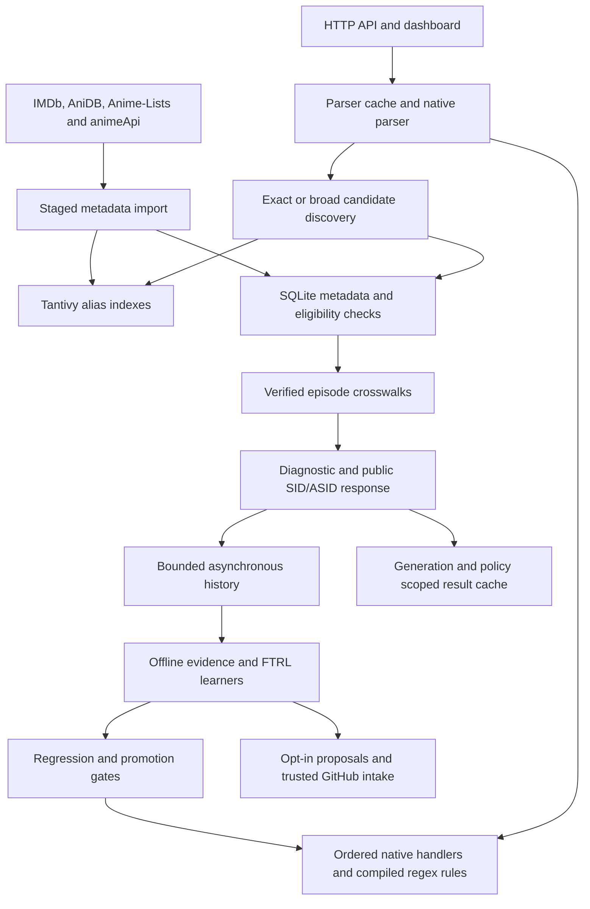

# MatchLab repository review

Review date: 2026-11-14. Baseline: [`db411d123f2a5d94da93ef52016f2a7c7972a1e6`](https://github.com/Dizzybog/MatchLab/tree/db411d123f2a5d94da93ef52016f2a7c7972a1e6).

Follow-up: [measured startup and live API accuracy audit](STARTUP_AND_ACCURACY.md)
includes exhaustive executed-title inventory, source-label comparisons against
the deployed service, real upstream alias spellings, and additional fixes.

## Assessment and method

MatchLab has substantial domain-specific protection: strict exact-title and year checks, independent IMDb/AniDB evidence, verified episode crosswalks, generation-scoped caches, staged metadata replacement, and conservative regex promotion. The most significant confirmed defect was an ambiguity check that could publish an AniDB identity when duplicate mapping rows concealed another equally strong identity. Other confirmed problems affected Unicode input, parser paths, cache provenance, metadata transport, and community-input isolation.

Graphify's promoted graph matched the checked-out baseline exactly: **2,066 nodes, 6,109 edges, 81 communities**. Repository listing, graph statistics, semantic queries, symbol definitions, callers, file neighbors, impact analysis, linked-test queries, and relevant recall informed the review. Findings were checked against local source; several were reproduced against the original implementation before changing it. Graphify describes the baseline, not the modifications in this PR.

The review covered the repository's principal execution paths and configuration: both Rust crates, parser handlers/prefilter and regression suites, IMDb/AniDB discovery and ranking, episode conversion, metadata download/import/indexing, history/dashboard contracts, learning/persistence/promotion/sharing, Python intake scripts, and GitHub/Docker workflows. Independent reviews covered parser, matcher/episodes, learning, server architecture, and automation; the cache changes received a separate cross-review. This is a broad source and regression review, not a formal proof or a measured production accuracy assessment.

**Graph coverage caveat:** linked-test and risk queries sometimes reported no tests for files with visible inline tests and test call edges. Those outputs guided inspection, but were not treated as runtime coverage measurements. The executed test suites are authoritative.

## Architecture and data flow

| Surface | Assessment |
| --- | --- |
| Parser | Broad existing corpus and field-specific handlers; repaired path/date/Unicode inconsistencies without changing generated handler regexes. |
| Matcher | Strict identity, year and word-boundary checks retained. Query-time Unicode fixes do not require an index migration. |
| Episode conversion | Ambiguity now considers all equally strong distinct coordinates; malformed arithmetic is rejected within existing canonical identifier bounds. |
| Metadata | Staged publication retained; HTTPS is enforced before transport, and Cinemeta buffering is bounded while reading. |
| Cache/history | Expensive work stays outside global cache locks; fixed waiter lifetime, parser provenance and maintenance namespace consistency. History/evidence remain separate. |
| Learning | ML remains advisory and regex-only. Mixed-pack labels and historical evidence now undergo stricter revalidation. |
| Community automation | Existing checksum, source/build and approval gates retained; malformed candidates cannot crash processing of valid siblings. |
| Dashboard/deployment | No dashboard behavior changes. Localhost Compose boundary remains appropriate to the documented lack of built-in authentication. Publication gating needs a follow-up. |

## Confirmed findings addressed

Priorities: **P1** can publish an incorrect identity; **P2** is a correctness, availability, lifecycle or security-boundary defect. Related failures are grouped below.

| ID | Priority | Trigger and original consequence | Improvement and regression evidence |
| --- | --- | --- | --- |
| R01 | P1 | Duplicate top-ranked map/link rows occupied both winner slots, hiding a third distinct, equally strong AniDB identity or episode. | `episode_crosswalk.rs` tracks ambiguity across every equally strong distinct coordinate in constant space. Duplicate rows, explicit pairs, reverse consistency and a 1,000-fixture independent reference are tested. |
| R02 | P2 | `The Voice KR S01E01` could panic by slicing the original UTF-8 title using a suffix length from its lowercase form; `UK` also generated the wrong alias. | `country_aliases.rs` matches and strips in the same string. Country expansion also removes per-request alias-table allocation/sorting. Kelvin-sign variants are compared with ordinary aliases. |
| R03 | P2 | Curly apostrophes and decomposed accents could fail strict alias word checks despite equivalent normalized names. | `imdb_matcher.rs` and `title_normalization.rs` align apostrophe/combining-mark semantics. Strict tests cover JoJo's, Amélie, separate-word rejection and exact one-letter `V`. |
| R04 | P2 | `新闻.2026/11/10...` became path components and could yield title `10` and episode 10. | Slash-date detection accepts Unicode alphabetic title evidence while retaining calendar and numeric-directory guards. Chinese and Cyrillic regressions cover valid and invalid dates. |
| R05 | P2 | An unmatched opening annotation such as `[broken/Example.Show.S01/S01E02.mkv` hid every descendant separator. | Path tokenization ignores unmatched opening positions in one additional linear pass only for malformed paths; balanced nested URL banners remain intact. |
| R06 | P2 | `V.1984/S01E02.mkv` lost its parent title because all ASCII one-letter titles were classified as generic. | Genuine one-letter titles are inherited; technical `S`/`E` remnants remain generic. `V`, `X` and `M` regressions verify title/year/coordinates. |
| R07 | P2 | The optimized title cleaner did not normalize NBSP, narrow NBSP, em-space or vertical tab consistently with the exhaustive cleaner. | Unicode-whitespace detection now preserves cleaner equivalence and the common ASCII fast path. |
| R08 | P2 | Live rule changes during parsing or before cache insertion could label an old value with a newer parser generation. Persistent writes independently chose the generation at write time. | `main.rs` captures provenance before loading, validates it, retries once, and fails on repeated changes. Memory and persistent writes retain the captured generation. Deterministic tests inject updates during loading. |
| R09 | P2 | A single-flight cache removed its key while waiters still held the old lock. Later requests could compute concurrently with those waiters after an error, uncacheable result or expiry. | `query_cache.rs` retains the registered lock until the final owner exits. Concurrent tests cover errors, uncacheable values, zero capacity and immediate expiry, plus final cleanup. |
| R10 | P2 | Cache maintenance compared raw metadata fingerprints with matcher/policy-scoped namespaces, marking every current match obsolete. | `learning_cache.rs` uses the same matcher semantic version and strict policy as result writes. Tests preserve current strict/broad entries and retire stale metadata, policy, matcher, parser and expired entries. |
| R11 | P2 | Malformed metadata offsets could overflow in debug builds or wrap in release builds; invalid coordinate ranges could reach unnecessary work. | Checked arithmetic and existing SID/ASID coordinate bounds are applied in crosswalk, independent AniDB and named-part helpers. Extreme offsets, invalid endpoints and oversized ranges are tested. |
| R12 | P2 | `/episode/resolve` could wait for a match slot or read missing metadata during initialization instead of returning readiness status. | Conversion returns retryable HTTP 503 before slot acquisition when metadata is waiting, indexing or failed; tests use a zero-slot semaphore. |
| R13 | P2 | `refresh-metadata-urls` accepted six URLs while its downloader required seven, so the CLI could not successfully dispatch a refresh. | CLI accepts the current seven sources and the legacy six-source form with configured ratings insertion. Actual-binary tests verify validation is reached before network or filesystem changes. |
| R14 | P2 | Unknown-length Cinemeta responses were buffered completely before checking the 16 MiB limit; HTTPS redirects were checked only after transport. | Read at most 16 MiB plus one detection byte, and enforce HTTPS in both clients before requests/redirects. Boundary, infinite-reader, early-stop and plaintext-transport tests cover these guards. |
| R15 | P2 | Valid JSON arrays/objects in discriminator fields, malformed Unicode, deep JSON or invalid marker/regex pairs could throw during community intake and abort valid sibling processing. | Explicit type/encoding/depth rejection and an adversarial field-mutation matrix preserve per-candidate isolation. Rust/Python corrective-epoch consistency is tested. |
| R16 | P2 | `Example.Show.S01E01-E02.S02E03` could become an incorrect single-range corrective training label. | Independent full-coordinate counting rejects mixed packs, with range/singleton, multiple-range, `NxM` and word-form tests. Corrective epoch 2 revalidates old observations; Python intake uses the same epoch. |
| R17 | Build | The application had no tracked Cargo lockfile, so independent CI/image builds could resolve different transitive dependencies. | Track the resolved application dependency set in `Cargo.lock`; CI and Docker use `--locked`. This pins Rust dependency resolution, not the floating base-image/toolchain tags. |

No speculative ranking changes or new fuzzy identity fallbacks were introduced. In particular, duplicate ambiguous episode mappings now remain unresolved instead of choosing an arbitrary candidate.

## Remaining findings and recommended follow-up

1. **P2 — Non-Latin title discovery.** `title_normalization::ascii_fold` removes all non-ASCII characters; fully CJK/Cyrillic names can produce an empty key, and matcher gates then skip discovery. Plan Unicode-preserving exact keys, a versioned metadata/Tantivy migration, and multilingual collision tests. Parser support alone does not solve retrieval.
2. **P2 — Discontinuous episode lists.** `labeled_episode_range` treats `Episode 11 & 13` as the interval 11–13 and reports three episodes. Define sparse-list semantics across `/parse`, `/match` and SID/ASID endpoint responses before extending or rejecting these inputs; otherwise episode 12 can be implied incorrectly. This PR does not claim that interval/list ambiguity is solved.
3. **P2 — Publication is independent of validation.** `.github/workflows/publish.yml` can publish `latest` from a main-branch commit while its Rust CI fails. Gate publication on successful checks of the exact same SHA, including native ARM64 verification, and retain a deliberate manual-release path.
4. **P3 — Repeated context-sensitive technical markers.** `Opus.2025.1080p.WEB-DL.Opus.mkv` keeps the correct movie title but can miss the valid later audio marker after rejecting the first title-word occurrence. The regex handler should continue to eligible matches, with field-removal/position regressions.
5. **Availability — Community status I/O.** `community_learning::status` opens/counts SQLite databases on a Tokio executor thread. Move the snapshot into `spawn_blocking`, following `/api/ml/status`, and check dashboard polling under a slow or locked volume. No latency claim was measured here.
6. **Maintainability and evidence.** Split the large HTTP/matching orchestration in `main.rs` by responsibility, preserving public/debug/dashboard policy contracts. Add real browser dashboard checks and a versioned multilingual release corpus with independently verified identities. Direct library consumers also lack a single parser-engine snapshot spanning a multi-component parse; HTTP generation validation now retries such changes.

## Validation

The following checks passed after integration of all changes, using Rust 1.100.0 on Linux x86_64. Tests use local fixtures; production-scale metadata downloads/imports and a real user metadata volume are outside this run.

- `RUSTFLAGS="-D warnings" cargo test --workspace --locked`: **497 passed**.
- `RUSTFLAGS="-D warnings" cargo test -p matchlab-parser --example audit_community_regex --locked`: **5 passed**.
- `RUSTFLAGS="-D warnings" cargo check --workspace --all-targets --locked`: passed, including parser benchmarks and examples.
- `PYTHONDONTWRITEBYTECODE=1 python3 -m unittest discover -s scripts/tests -v`: **85 passed**.
- Native FTRL model self-test and synthetic 10,000-sample benchmark smoke command: passed using the debug binary.
- `git diff --check`: passed.

The Python suite had 79 tests at baseline. The integrated workspace includes **119 parser tests**, four of them new parser regressions, **364 server unit tests**, and **14 server integration tests**. The separate native regex auditor adds five tests, for **502 Rust tests** overall. Cargo 1.100 also emits an existing advisory that the parser package's homepage duplicates its repository URL; compiler warnings are denied by the commands above.

No percentage accuracy improvement, throughput gain, p95/p99 latency reduction or production-memory benchmark is asserted. Structural improvements remove repeated country-table sorting, maintain one query flight per key, preserve useful cache entries, and cap external response buffering. Docker image builds and native ARM64 execution require the configured CI runners; source-level checks do not substitute for those checks.
